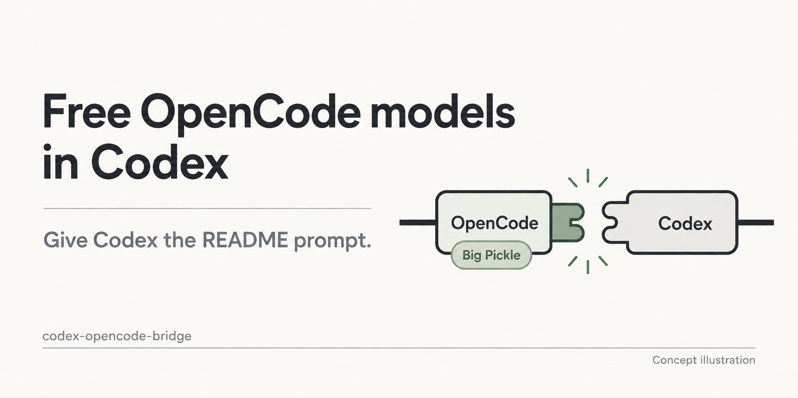
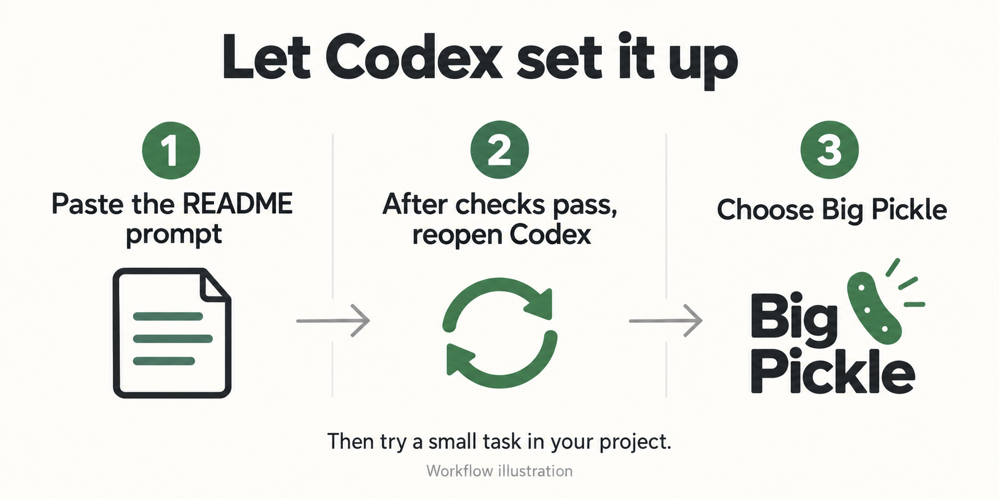

# 把 OpenCode 的免费模型接进 Codex

继续用 Codex 的界面，在模型菜单里多一个免费模型。

中转方案已经写好。把下面这段 prompt 交给 Codex，让它完成安装和测试，
重开后选已安装的模型，就可以开始试用文字和代码任务。
原来的 GPT、其他模型和登录会保留。

不用提前下载仓库、打开终端或手动改配置。

[English](../README.md) · [安装操作手册](agent-install.md)



*图里的 Big Pickle 是一个例子，其他候选模型见下表。*

## 可以尝试哪些免费模型？

目录和官方免费标价核对日期：**2026-10-29**。首次安装仍默认选 Big Pickle。
**10 月 30 日已分别尝试剩余六款**：MiMo 和 Nemotron 3.5 Lightning 返回限流；
DeepSeek、Beam、Nemotron 3.5 Super VL 和 GLM 在文字阶段返回生成失败。
没有模型进入文件工具检查，因此本轮未新增安装配置，历史通过记录仍按原日期保留。

| 当前免费候选 | 在本项目里的路径 |
| --- | --- |
| Big Pickle | 默认配置；10 月 29 日文字检查遇到限流，历史文字和文件任务检查通过。 |
| MiMo-V2.6-Flash Free | 已有实验配置；10 月 30 日文字检查返回限流。 |
| Flint 40B Free | 10 月 29 日文字检查失败（`generation_failed`），未进入文件工具检查；不加入安装选项。 |
| Beam Free | 10 月 30 日文字检查返回 `generation_failed`；未新增配置。 |
| DeepSeek V4.1 Flash Free | 10 月 30 日文字检查返回 `generation_failed`；未新增配置。 |
| GLM 5.3 Flash Free | 10 月 30 日文字检查返回 `generation_failed`；未新增配置。 |
| Nemotron 3.5 Lightning Free | 10 月 30 日文字检查返回限流；未新增配置。 |
| Nemotron 3.5 Super VL Free | 10 月 30 日文字检查返回 `generation_failed`；图片未验证。 |

**Space Bunny Free、LongCat 2.5 Preview Free、LL Alpha Free，以及 Muse Spark
1.2／1.3 Contributor Free 已不在当前 API 目录中**，不再建议新安装时选择。
保留已有配置和历史测试记录，供已有安装诊断使用，不代表当前仍能调用。
Nemotron 3 Ultra Free 仍有免费标价，但 API 目录中没有。

与 10 月 17 日相比，新增的免费 ID 只有 Flint。本次实测未通过，因此没有新增它的安装配置。
上表六款没有维护配置的候选，
需要先适配并验证，才能通过安装器选择。当前目录里的免费候选中，本项目尚无
已验证的图片路线。DeepSeek V4.1 与旧 V4 是不同 ID，不会自动替换模型。
[准确 ID、目录变化和分日期的测试记录](free-models.md) ·
[10 月 30 日实测结果](receipts/free-models-live-20261030.json)。
后续诊断确认 Big Pickle 的 429 来自上游免费额度限制，响应未提供具体重置时间。
单款 429 不能证明免费模型共用同一个额度池，也不能代替其他模型的测试。
[限流诊断](free-models.md#october-29-quota-diagnosis)。

想试已有配置的 MiMo，可以在安装对话中明确说出模型名，
让 Codex 按操作手册安装、验证文字和文件任务；失败时报告原因，不自动换模型。

## 第一步：让 Codex 帮你装

需要已经安装 Codex，并且有一个能正常使用的模型来执行安装。
这条安装路径适用于 **macOS Apple Silicon**。

新建一个**本地对话**，选择任意项目文件夹，空文件夹也可以。
把下面整段复制给 Codex：

```text
请帮我在这台 Mac 的 Codex 中安装并配置 codex-opencode-bridge：
https://github.com/Hubuguilai/codex-opencode-bridge
请下载仓库 main 分支，先阅读 README 和 docs/agent-install.md，再实际完成安装，
不要只给我操作步骤。我没有提前下载项目或准备运行环境，请你检查并准备所需依赖。
默认安装 Big Pickle，并验证所选模型；选择其他模型前先检查 docs/free-models.md。
请使用项目提供的统一安装入口，保留已有 GPT、其他模型、登录和配置。
我授权运行所选模型的必要验证；不要替我购买订阅、充值或开启付费后备。
需要我登录 OpenCode 或完成系统授权时，一次告诉我一个具体操作；API Key 只在
本地登录窗口输入，不要让我发进聊天。完成后报告测试结果，并告诉我重开 Codex 后
应该选择哪个模型。若失败，请诊断并修复可逆问题，明确仍需我处理的事项。
```

第一次先用默认的 **Big Pickle**，不用先选模型，也不必先买 OpenCode Go 订阅。
Codex 会在安装时检查你当前能否使用它。
如果遇到登录或 Apple 开发工具安装提示，完成那个操作后回到同一对话，让它继续。



*图中展示默认的 Big Pickle 路线；如果安装的是其他模型，重开后选择对应模型即可。*

## 第二步：重开 Codex，选模型试一下

等 Codex 报告测试通过后，**完全退出 Codex，再重新打开**。
在输入框旁的模型菜单里选择已安装的模型。默认安装对应的名称是：

**Big Pickle (OpenCode Native Bridge)**

先在空文件夹里新建对话，发一句：

```text
在当前文件夹创建 hello.txt，写入 hello，再读取文件确认内容。
```

这一步检查的是能否调用文件工具，只回一句话还不够。
通过后，再拿自己项目里的小任务试试：解释一个脚本、改一个函数，或者修复一个报错。

## 目前实际测过什么？

2026-09-30 的检查中，Big Pickle 在全新的 OpenCode 用户目录里，无需账号或 Key 就能回答。
在隔离的客户端状态下，实际 Codex 文字和文件任务、重复安装及卸载也已通过。

另一台 Mac 或新的 macOS 用户账号，从首次安装到重开后观察模型菜单，还没有完成独立验收。
当前版本是实验性预发布版 **0.2.0-rc.1**。

[实测记录](onboarding-verification.md) · [已验证范围与已知限制](public-release.md)

## 常见问题和恢复

<details>
<summary>免费模型需要账号或 API Key 吗？</summary>

上面的检查中，Big Pickle 无需账号或 Key 即可使用。
免费供应、限流和地区规则可能变化，安装时会实际检查你能否使用这条路径。

这里接入的是 OpenCode 模型，不会增加原来 GPT 的订阅额度，也不提供共享账号或 Key。

如果所选模型需要认证，Codex 会给你本地登录入口。
Key 只在那个入口输入，不要发进聊天。
默认安装路径不要求你购买 Go、充值或开启付费后备。

[需要登录时，查看账号和 Key 的操作步骤](opencode-access.md)

</details>

<details>
<summary>能看图吗？能接 OpenCode 里的其他模型吗？</summary>

Big Pickle 用于文字、代码和文件任务，不支持看图。

历史的 Muse Spark 1.3 Contributor Free 配置支持图片传递，但该免费 ID 已不在
10 月 29 日的 API 目录中，不再建议新安装时选择。已有安装需要先重新确认访问权限，
不要自动替换为收费的 Muse 模型。

Big Pickle 是默认安装路线；MiMo V2.6 Flash Free 有实验性的文字／工具配置。
其他当前候选需要先补配置并验证。名字里有 VL 不会自动启用桥接的图片能力。
不支持原生音频、视频或 PDF 输入。Intel Mac 尚未实测；Windows/Linux 暂不提供
这条桌面安装路径。

[模型能力与证据](advanced.zh-CN.md#模型能力与证据)

</details>

<details>
<summary>没装好，或者菜单里有模型但任务失败了</summary>

回到安装时的 Codex 对话，复制这段：

```text
请诊断我的 codex-opencode-bridge 安装。先查找之前的项目目录和安装记录，阅读其中
的 docs/agent-install.md 和 docs/troubleshooting.md。不要覆盖配置或重装一遍碰运气。
检查 status、后台服务、模型菜单注册以及实际失败的模型；区分仓库下载失败、缺依赖、
OpenCode 登录、地区/模型权限、429 限流、图片不支持和流中断。
不要输出 Key、认证文件或原始私有对话。只用项目维护的恢复方式处理可逆故障。
告诉我出了什么问题、修复并验证了什么，以及现在只需要我完成的一个操作。
```

模型菜单出现、后台服务在运行，都不能代替实际任务检查。
按失败信息诊断，避免反复重装。

</details>

<details>
<summary>以后怎么升级或卸载？</summary>

继续在安装时的 Codex 对话里说“检查桥接是否正常”“升级并验证”，
或者“卸载桥接，保留我的其他模型和登录”。
具体操作由它按[安装操作手册](agent-install.md)完成。

</details>

用得上就点个 star。遇到问题可以[提个 issue](https://github.com/Hubuguilai/codex-opencode-bridge/issues)，
写清模型名和去掉隐私信息的报错，不要贴 Key 或私人对话记录。
